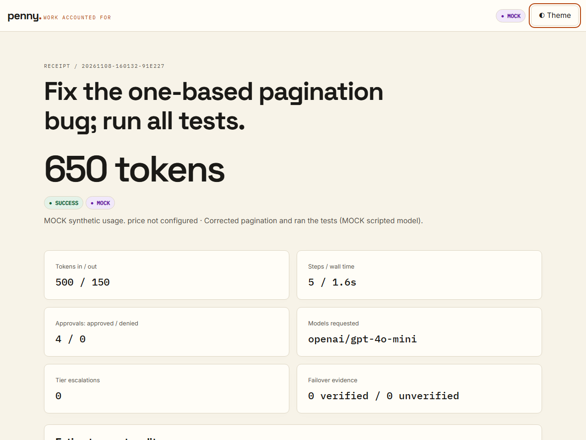
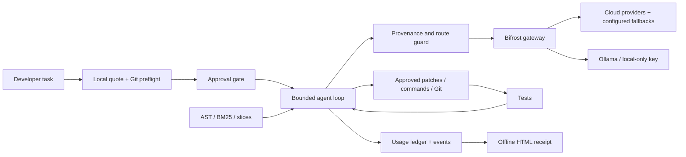

# Penny

**The coding agent that tells you the price before it acts.**

Penny is a CLI coding agent for solo developers, students, and freelancers who want a quote before model usage, approval before repository changes, and an itemized receipt afterward. Every real model call goes through the **Bifrost AI gateway**.

**Quote → Approve → Receipt.** Search symbols, read a small slice, approve a patch, run tests, and keep the accounting on your machine.



## Submission status

The implementation, offline end-to-end demo, tests, static reports, Compose stack, virtual-key bootstrap, and gateway local-key restriction have been exercised. [Verification evidence](docs/VERIFICATION.md) lists exact commands and boundaries. Screenshots are explicitly **MOCK**: synthetic model usage, with real filesystem edits and real pytest execution.

**Real model task completion, provider failover, a paid spending-cap demonstration, and local model inference require provider credentials or a running Ollama model.** These are not represented as verified. Benchmark: **Not yet run**. Other coding products: **not compared**.

## The problem

Developers need to understand an agent's likely cost and review what it intends to change. [WebProNews reported developer complaints about opaque token usage and unpredictable bills](https://www.webpronews.com/claude-codes-hidden-cost-problem-developers-sound-the-alarm-on-anthropics-ai-coding-agent-billing-practices/). Those are reported experiences, not Penny measurements or a current product comparison.

The project brief also references [Verdict's report of a founder's database-deletion account](https://www.verdict.co.uk/?p=401002) and [Waxell's billing-shock analysis](https://waxell.ai/blog/github-copilot-billing-shock-agentic-cost-enforcement-2026). Waxell is a vendor source. These two supplied URLs could not be retrieved during this build, so their specific timings, quantities, and conclusions are not asserted here.

Penny uses a contractor workflow: a local estimate, explicit decisions, and a receipt that records failures and denials alongside successful work.

## Features and hackathon fit

| Track requirement | Implementation | Evidence / boundary |
|---|---|---|
| Complete tasks with fewer tokens | AST/symbol maps, BM25, bounded slices, exact patches, deduplication, compaction, model tiers, short outputs | Real edits/tests with scripted actions verified; savings require the real benchmark |
| Continue through provider outages | Bifrost request-level fallbacks; 503/429/timeout chaos proxy | Request and fault behavior tested; real provider recovery not run |
| Individual spending limits | Agent cost/token preflight plus separately budgeted gateway keys | Agent stop/error paths tested; keys created on real Bifrost; paid exhaustion demo not run |
| Confidential repositories | Provenance guard, masking, Ollama-only key, no local-to-cloud fallback | Unit tests and real gateway cloud rejection with local key |
| Approval before risky operations | Exact diffs/commands, risk labels, branch per run, blocked patterns | Offline integration and adversarial-command tests |
| Correctness and usable audit trail | Test-before-finish, JSON records, offline HTML, guarded undo | Mock vertical slice and browser QA |

Penny is a CLI plus a static report generator. It has no frontend build, hosted receipt service, or multi-agent framework.

## Quick start without keys

Requirements: Python 3.11+, Git, and a POSIX shell. Linux through WSL was tested; macOS is configured in CI but was not run locally. Native Windows is best-effort.

```bash
git clone https://github.com/hannielvinu/Penny.git
cd Penny
python3 -m venv .venv
source .venv/bin/activate
python -m pip install -e '.[dev]'
python scripts/record_demo.py --mock --output .penny/demo
```

The demo creates a synthetic shopkit Git repository in the OS temp directory, injects a pagination bug, and performs search → symbol read → patch → tests → receipt. Only this MOCK development harness uses scripted approvals. Open `.penny/demo/MOCK-receipt.html`. The terminal also prints the retained sandbox path for inspection and undo. Mock token counts are synthetic and excluded from history and benchmarks. The default mock sequence is specifically for the pagination fixture; it cannot solve arbitrary tasks.

## Real gateway setup

Run these commands from the checkout in one shell environment. On Windows, use WSL for the entire workflow so Python, Docker, Git and `localhost` refer to the same environment.

1. Install Penny as above, Docker with Compose, and optionally host Ollama.
2. Prepare an untracked environment file and a random gateway setup token:

   ```bash
   python scripts/bootstrap_bifrost.py --prepare
   ```

   Existing `.env` is not overwritten. Copy missing settings from [`.env.example`](.env.example). Fill `OPENAI_API_KEY` and/or `ANTHROPIC_API_KEY` for the providers you will use. Provider credentials are consumed by the gateway; Penny's client uses virtual keys.

3. Start Bifrost and the outage harness:

   ```bash
   make up
   # Equivalent: docker compose up --build -d --wait
   ```

   Published ports are loopback-only: gateway `8080`, chaos `8099`. Bifrost is pinned to `maximhq/bifrost:v2.4.0`. OpenAI goes through the initially healthy chaos proxy. Anthropic uses its gateway provider. The Compose volume retains configuration/log state. `make down` stops services without deleting the volume.

4. Create virtual keys:

   ```bash
   python scripts/bootstrap_bifrost.py
   ```

   This intentionally prints newly created key values: put them in the matching `.env` variables privately. Rerunning preserves existing keys. If gateway dashboard authentication is enabled, set `BIFROST_MANAGEMENT_TOKEN` instead of using the setup token. Finish first-admin setup in Bifrost's UI before exposing it beyond this local configuration.

   | Key | Providers | Gateway budget | Rate limit |
   |---|---|---|---|
   | `penny-dev` | OpenAI, Anthropic | 0.50 USD / rolling day | 60 requests/min, 150k tokens/hour |
   | `penny-local` | Ollama only | Local compute unpriced | Same request/token limits |
   | `penny-demo-tiny` | OpenAI, Anthropic | 0.001 USD / rolling day | Same request/token limits |

   These are configured **limits**, not model prices. Gateway accounting can overshoot by an in-flight request; a budget is not a prepaid reservation for every generated token. [Gateway details](bifrost/README.md).

5. Pull a local coding model when using private mode:

   ```bash
   ollama pull qwen2.5-coder:7b
   ```

   `OLLAMA_BASE_URL` is seen from the container, default `http://host.docker.internal:11434`. On Linux, Ollama must listen on a host interface reachable from Docker. Restrict host access; do not expose Ollama publicly. Restart Bifrost after changing its environment.

6. Configure the target repository and prices:

   ```bash
   cp pricing.example.yaml pricing.yaml
   penny init --repo /path/to/your/git/repository
   ```

   Set actual supported model IDs in the target's `.penny/policy.yaml`; shipped IDs are placeholders. Place a filled `pricing.yaml` in the target too, with provider-page URLs and checked dates. Keep prices untracked. Commit the `.gitignore` changes made by `init`; start with a clean tree and at least one Git commit.

7. Check, estimate and run:

   ```bash
   penny doctor --repo /path/to/repository
   penny pricing check --repo /path/to/repository
   penny quote "Fix pagination" --repo /path/to/repository
   penny run "Fix pagination" --repo /path/to/repository
   penny report --repo /path/to/repository --open
   ```

   Environment variables come from the current directory's `.env` or the shell. `doctor` sends a tiny cloud-model probe with the local key to check rejection. A misconfigured key could permit that request; the result is reported explicitly.

## Commands

| Command | Purpose |
|---|---|
| `penny init [--repo PATH]` | Create policy and metadata ignore rules |
| `penny doctor [--repo PATH] [--plain]` | Check environment, prices, gateway, model listing and key isolation |
| `penny quote TASK [--private] [--json]` | Local estimate without a model call |
| `penny run TASK` | Quote, approve, act, test, receipt |
| `penny receipt [RUN_ID] [--open]` | Regenerate/open a stored receipt; latest by default |
| `penny report [--open]` | Generate local run ledger and benchmark page |
| `penny undo [RUN_ID]` | Approve restoring base state; refuse subsequent changes |
| `penny chaos on --mode 503` | Simulate an outage; also `429` and `timeout` |
| `penny chaos off` / `status` | Restore/check proxy |
| `penny pricing check` | Report configured-model prices and missing entries |
| `penny bench --n 3 [--task ID] [--ablate TOGGLE]` | Real-only benchmark from this source checkout |
| `penny version` | Installed version |

`run` flags: `--repo`, `--budget`, `--private`, `--tier cheap|strong|auto`, `--max-steps`, `--yes-quote`, `--non-interactive`, `--allow-dirty`, `--plain`, `--json`.

`--yes-quote` approves only the quote. Noninteractive and JSON runs deny writes, Git changes and non-allowlisted commands. JSON mode emits JSON Lines on stdout; notices go to stderr. There is no broad automatic-approval flag. Interactive options are `y` yes, `n` no, `a` subsequent non-delete writes, `d` full diff, `q` quit. Shell/Git approval remains separate.

Exit codes: **0** success, **1** task failed, **2** usage/configuration error, **3** gateway error, **4** budget stop, **5** abort or initial approval denied. Later denials are sent back to the model so it can adapt.

## Policy and pricing

Full examples: [`policy.example.yaml`](policy.example.yaml), [`pricing.example.yaml`](pricing.example.yaml). Unknown fields are rejected.

```yaml
# .penny/policy.yaml excerpt; retain the other generated fields
confidential: false
confidential_globs: ["internal/**", "config/prod/**"]
on_confidential: go_local  # go_local | withhold | block
test_command: "python -m pytest -q"
limits:
  budget_usd: 0.50
  max_steps: 25
  max_prompt_tokens: 12000
  max_output_tokens: 800
  max_wall_seconds: 900
  token_cap: 150000
```

The secret-path denylist excludes `.env*`, private keys, `.aws`, `.ssh` and `.git` regardless of policy. Maps, search results, slices and tool output carry sensitivity. Once confidential context uses a local route, derived conversation stays local. `withhold` substitutes a file-withheld notice; `block` stops.

```yaml
# pricing.yaml — user-maintained and untracked
models:
  openai/gpt-4o-mini:
    input_per_1m_usd: null
    output_per_1m_usd: null
    source_url: ""
    checked_on: ""
```

Set both prices, an HTTPS source URL and an ISO date to enable cost accounting. Null prices show **price not configured**. Ollama compute is **not priced**, rather than assumed free. Unknown prices or uncertain fallback identity keep total cost unknown; the token cap applies. Estimates are approximate; provider-reported usage is authoritative.

## Architecture and Bifrost



- Inference: `POST /v1/chat/completions`, `x-bf-vk` and documented `fallbacks` array.
- Governance: API-created provider-restricted keys with budgets and rate limits.
- Local inference: `ollama_key_config.url` from the gateway environment.
- Outage demo: OpenAI's gateway base URL points at the fixed-upstream chaos proxy.
- Observability: reported usage and available metadata are recorded. Only metadata-evidenced failover is claimed; missing metadata is marked unverified. Semantic caching is not enabled or claimed.

[Architecture](docs/ARCHITECTURE.md) · [Security](docs/SECURITY.md) · [Decisions](docs/DECISIONS.md).

## Benchmark

<!-- RESULTS:START -->

**Not yet run.** No real token-saving or cost-saving claim is made.

<!-- RESULTS:END -->

Eight tasks and the simple whole-file baseline were pre-registered in commit `1007664` before real measurements. Deterministic synthetic shopkit contains 40 business modules; its clean suite passes and each injected task fails. After setting real keys/models, run `make bench`. Default sample: 8 tasks × 2 agents × 3 repetitions = 48 fresh-copy runs.

Raw usage, failures, acceptance results, model IDs, commit, task fingerprints and means with min–max ranges are saved. Independent acceptance re-runs the full suite and checks changed-file restrictions. Mock mode is refused. Small samples are labelled. Other products were not compared. [Method](docs/BENCHMARK.md).

## Development and reports

```bash
make lint
make test
make build
mypy src/penny
python -m pytest tests/test_real_gateway.py --real -q
# Optional browser verification:
python -m pip install -e '.[browser]'
python -m playwright install chromium
python scripts/screenshots.py .penny/demo/MOCK-receipt.html --mock
```

Default tests use scripted models/in-process transports and block accidental network connections. CI is configured for Python 3.11–3.13 on Linux/macOS; [verification](docs/VERIFICATION.md) distinguishes observed runs. Fontsource Latin WOFF2 assets and OFL licenses are vendored, then embedded into HTML. Refresh with `bash scripts/vendor_fonts.sh`.

`make install` installs the tested `requirements-dev.lock` snapshot before the editable package. The six Linux/macOS CI jobs passed on the final implementation commit, covering Python 3.11, 3.12 and 3.13. Local WSL verification passed 160 tests; the explicit live-gateway isolation test passed separately. Safety, route-guard, cost and patch coverage exceeded 99% in aggregate; each requested area exceeded 90%.

Records: `.penny/runs/<id>/run.json`, `events.jsonl`, redacted full command output in `raw/`, `receipt.html`. Index: `.penny/index.html`. Receipts show quote error, steps, approvals, diffs, tests, budgets, failover evidence and undo instructions. Runtime records can contain proprietary code even after masking: treat them as private.

## Limits

Python is first-class; other-language extraction is best-effort. Passing tests do not establish complete correctness. Approved tests/commands execute repository code with host permissions: Penny is **not an operating-system sandbox**. Pattern scanning can miss secrets. Concurrent filesystem changes remain a risk. Use disposable copies and restricted permissions for unfamiliar code.

Quotes are rough, prices can become stale, and in-flight requests can overshoot limits. Private routing does not isolate a compromised gateway, a network-capable local service, or approved shell programs. Undo refuses ambiguous state and cannot reverse external side effects. Local model quality varies. [Full limitations](docs/LIMITATIONS.md).

## Submission kit

[Demo script](docs/DEMO_SCRIPT.md) · [Pitch and Q&A](docs/PITCH.md) · [Submission copy](docs/SUBMISSION.md) · [Progress](docs/PROGRESS.md) · [Verification](docs/VERIFICATION.md).

Stack: Python, Typer, Rich, Pydantic, pydantic-settings, httpx, PyYAML, pathspec, FastAPI, uvicorn, pytest, Ruff, mypy, Docker Compose, Bifrost, optional Ollama and Playwright. No provider SDK or frontend build.

**AI usage:** An AI coding assistant helped write and test this implementation. Commits use the repository owner's configured identity. Human review before submission is pending; the repository does not claim review that has not occurred.

MIT License · Copyright (c) 2026 Hanniel Vinu.
