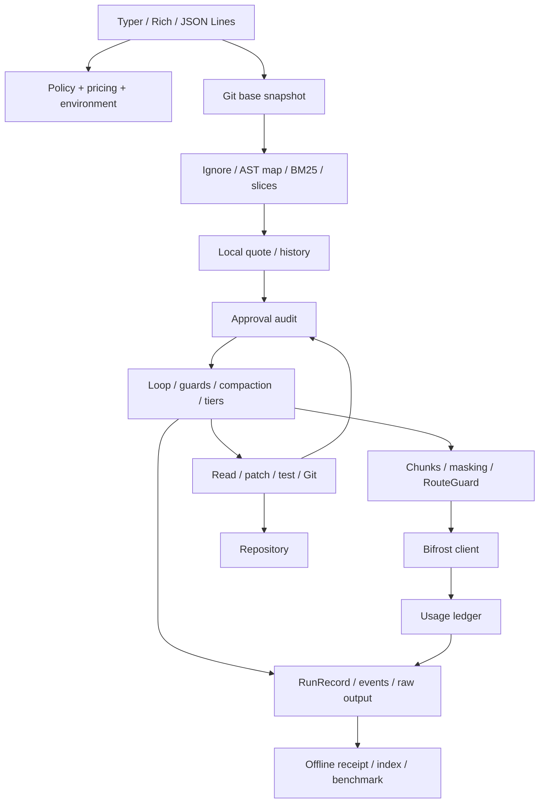

# Architecture

Penny separates model proposals from repository capabilities. Strict JSON actions
are validated before dispatch. Tools independently enforce paths, risk, approvals
and routing. Model output is not evaluated as code.

## Data flow

1. Validate policy and prices. Require a Git root with a base commit. Dirty starts
   require an explicit flag and disable automatic undo.
2. Build the hash-cached symbol map, excluding ignored/secret/binary/oversized paths.
   Quote locally using a similar-size history median after three real runs, otherwise
   wide cold-start constants. Mock history is excluded.
3. Ask for quote approval and branch approval. The quote flag approves no mutation.
4. Construct stable system/map context, fetch slices on demand, deduplicate unchanged
   reads and compact old context deterministically without an LLM summary.
5. Mask and label every chunk before HTTP. Maximum sensitivity selects the route.
   Confidential local context pins derived conversation locally. Withhold/block
   policies operate before routing; the client repeats the RouteGuard assertion.
6. Check next-call cost estimate for model/fallbacks and an independent token cap.
   Unknown prices remain null. Call Bifrost and record provider or estimated usage.
7. Validate one action, repair malformed JSON once, escalate on repeated failures.
   Read-only de-escalation probes cannot execute mutations without strong review.
8. Present exact diffs/commands with risk labels. BLOCKED cannot execute. Automatic
   commands require normalized exact equality and LOW risk.
9. Require a passing `run_tests` after modifications before accepting `finish done`.
10. Finalize JSON, events, raw output and HTML on success, failure, denial, budget stop
    and normal interruption. Abrupt process/disk failure can interrupt finalization.

## Components and state

`agent/` coordinates; `repo/` retrieves; `safety/` authorizes; `exec/` acts;
`gateway/` transports; `cost/` accounts; `report/` renders. `chaos/` is a separate
development harness. `mock/` is a labelled test double, not a general coding model.

Policy is per target repo. Pricing lives in target `pricing.yaml`. Environment
comes from the current shell directory. Private runtime state is ignored under
`.penny/`. Reports embed CSS, JavaScript, SVG and licensed fonts; CSP denies external
resource loads and network connections.

The benchmark uses fresh marked temporary Git repos and independent acceptance.
Normal CLI runs cannot instantiate its auto approver through flags.

## Failure behavior

| Condition | Response |
|---|---|
| Dirty tree, invalid policy | Refuse before model usage |
| Quote or branch denied | Denied receipt, no model call |
| Later operation denied | Feed denial back to model |
| Bad JSON | Repair instruction; repeated failures escalate or abort |
| Ambiguous patch or concurrent edit | Feedback instead of a partial write |
| Prompt/token/step/wall/progress cap | Stop with receipt |
| Agent cost cap | Explicit extension option interactively; otherwise stop |
| Gateway budget error | No retry; record gateway layer |
| HTTP 429 | At most two retries, respecting bounded Retry-After |
| Transport timeout | Stop to avoid duplicating a possibly billed call |
| Cloud outage | Configured Bifrost fallback; report only evidenced recovery |
| Local provider unavailable | Stop; no cloud fallback |
| Undo after subsequent changes | Refuse and preserve work for manual review |
